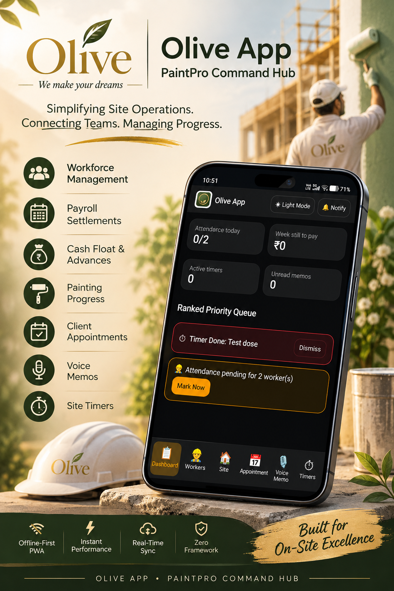
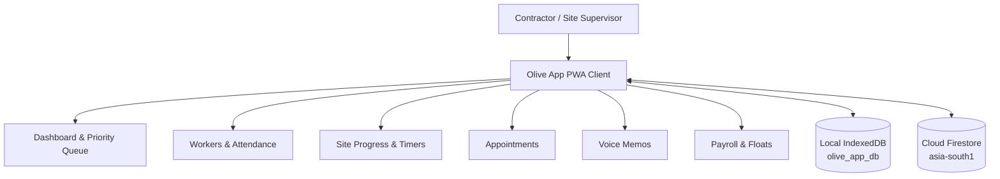

# Olive App — PaintPro Command Hub 🎨📱

> A lightweight, mobile-first operations hub for painting contractors to coordinate workers, monitor site activity, manage payments, and keep day-to-day work organized.

<p align="center">
  
</p>

---

## 📌 Project Summary

- **Project Name:** Olive App
- **Product Title:** PaintPro Command Hub
- **Architecture:** Zero-Framework Progressive Web App (PWA)
- **Primary Use Case:** Painting contractor operations, field labor tracking, site stages, and client appointments
- **Brand Tagline:** *We make your dreams*

---

## 🎨 Overview

Olive App is designed to simplify field site management for painting contractors and turnkey solution providers. It consolidates site management and workforce activities into a high-speed, mobile-friendly interface so contractors or site supervisors can check real-time progress and manage attendance without needing a desktop setup.

The dashboard provides an instant operational snapshot: worker attendance, weekly payroll balances, active task timers, unread voice memos, and a prioritized action queue.

---

## ✨ Key Features

### 📊 Dashboard & Priority Queue
- **Operational Summary Cards:** Instant counters for attendance today, weekly pending payouts, active drying timers, and unread memos.
- **Ranked Priority Queue:** Highlighted alert stack surfacing completed drying timers and pending attendance items.
- **Quick Action Triggers:** One-tap dismissal of alerts and immediate attendance navigation.

### 👷 Workforce & Attendance Management
- Dedicated worker management panel with historical wage rate tracking.
- Attendance toggling for active field teams with visual pending notices.
- Permanent worker removal controls with confirmation dialogs.

### 💰 Payroll & Cash Float Ledger
- Dynamic weekly earnings and balance calculation in Indian Rupees (₹).
- Cash float (advance) ledger with instant entry and reversal history.
- Week settlement locking to finalize payroll totals once paid.

### 🏗️ Job Site Progress & Drying Timers
- Site-level tracking with room tagging and stage checklists (e.g., Sanding, Primer, Finish Coat).
- Built-in timer engine with Service Worker notifications for time-sensitive paint curing cycles.

### 📅 Client Appointments
- Client scheduling card view with direct Call launcher and WhatsApp message links.

### 🎙️ Offline Voice Memos
- Web Audio API voice recorder for on-site field notes.
- Audio payloads saved directly to device storage to avoid cloud bandwidth limits.

### 📱 Native PWA Experience
- Installable directly to mobile home screens with zero browser address bar overhead.
- Optimized for direct sunlight visibility with high-contrast Dark and Light modes.

---

## 📸 Media & Visual Assets

Place your promotional graphics and UI screenshots inside the `assets/` folder:

```text
assets/
├── olive-app-hero.png       # Main promotional banner poster
├── dashboard-preview.png    # Mobile UI dashboard screenshot
├── workers-ledger.png       # Attendance & float ledger screenshot
└── site-stages.png          # Room progress checklist screenshot
```

---

## 🏗️ Architecture & Technology Stack

Olive App operates on a **zero-framework, client-first model**. It eliminates runtime dependencies like React, Vue, or Flutter to achieve 0 KB framework overhead and sub-second launch times on mobile devices.

### Technical Breakdown

| Layer | Component / Technology | Operational Role |
| :--- | :--- | :--- |
| **Frontend UI** | HTML5, CSS3, Vanilla JS (ES6+) | Native browser rendering with 0 KB framework overhead |
| **PWA Layer** | Service Worker (`sw.js`) | Offline shell caching, asset delivery, and background timers |
| **App Manifest** | `manifest.webmanifest` | PWA installation settings, icons, and display configurations |
| **Local Database** | IndexedDB (`olive_app_db`) | Stores app state (`kv` store) and binary audio clips (`memos` store) |
| **Cloud Database** | Google Firebase Firestore | Real-time multi-device cloud sync (`asia-south1` / Mumbai region) |
| **Static Hosting** | GitHub Pages | CDN asset delivery for the PWA client |

### High-Level Data Flow



---

## 💾 Dual-Storage Engine Mechanics

1. **Local Disk Storage (IndexedDB - `olive_app_db`):**
   - App state (`S`) is cached locally inside the `"kv"` store for instant offline startup.
   - Voice memos are recorded via the browser Web Audio API and stored as binary `Blob` objects in the `"memos"` store, staying 100% local to save bandwidth.

2. **Cloud Synchronization (Google Firebase Firestore):**
   - Text data (workers, attendance, floats, sites, appointments) syncs bi-directionally across devices via `olive_hub/main_hub`.
   - Allows supervisors on different phones to view live attendance updates.

---

## 📁 Repository Structure

```text
olive-app/
├── index.html              # Core SPA HTML structure & container views
├── js/
│   └── app.js              # State engine, DOM renderer, IndexedDB & Firestore handlers
├── css/                    # Custom layout styles, theme variables, and component CSS
├── assets/                 # App banners, poster images, and screenshot graphics
│   └── olive-app-hero.png
├── manifest.webmanifest    # PWA installation metadata & icons
├── sw.js                   # Service Worker cache controller
└── README.md               # Repository documentation
```

---

## 🚀 Getting Started

### Local Setup

Because Olive App uses native browser technology, no Node.js environment or `npm install` step is required.

1. Clone the repository:
   ```bash
   git clone https://github.com/blessonbiju2006/olive-app.git
   cd olive-app
   ```
2. Open the project folder in **VS Code**.
3. Start a local server (e.g., using VS Code **Live Server** extension or Python):
   ```bash
   python -m http.server 8000
   ```
4. Open your browser and navigate to `http://localhost:8000`.

### PWA Cache Maintenance Pipeline

When releasing code updates to mobile PWA installations:

1. Open `sw.js`.
2. Bump the cache version string:
   ```javascript
   const CACHE_NAME = 'olive-app-v5'; // Increment version (e.g., v4 -> v5)
   ```
3. Commit and push the changes:
   ```bash
   git add .
   git commit -m "Bump service worker cache version to v5"
   git push origin main
   ```

---

## 💡 Operational & Commercial Overview

- **Commercial Setup Valuation:** Estimated at **₹45,000 – ₹60,000** for a full custom client implementation package.
- **Operational Infrastructure Costs:** Currently **₹0 / month** by combining free static hosting on GitHub Pages with Google Firebase's free Spark tier limits (up to 50,000 daily reads and 20,000 daily writes).
- **Maintenance Retainer:** Standard market support retainers run **~₹8,000 / year** for software updates and database maintenance.

---

## 📜 License & Branding

Designed and developed for **Olive** (Interior Design, Turnkey Solutions & Painting Services, Kerala, India). All rights reserved.

<p align="center">
  <strong>Olive App — PaintPro Command Hub</strong><br>
  <em>Simplifying site operations. Connecting teams. Managing progress.</em>
</p>