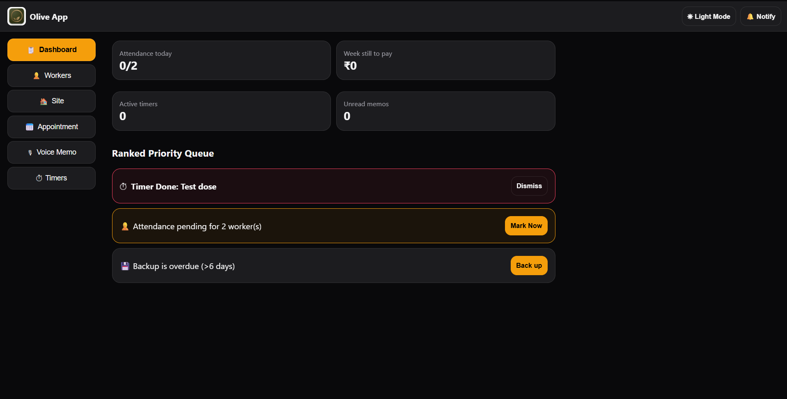

# Olive App — PaintPro Command Hub 🎨📱

<p align="center">
  
  
  
  
  
</p>

> A lightweight, zero-framework, offline-first Progressive Web Application (PWA) engineered for painting contractors, interior designers, and field labor management teams.

---

## 📸 App Screenshots & Preview

<p align="center">
  
</p>

<p align="center">
  <i>Main Command Dashboard — Attendance tracking, wage rate calculations, float advance ledgers, and site stage progress.</i>
</p>

---

## ✨ Key Features

* **⚡ Zero-Framework Speed:** Built with pure HTML5, CSS3, and JavaScript (ES6+). Operating with **0 KB framework overhead**, it boots in milliseconds on low-end mobile hardware under field conditions.
* **📶 Offline-First Storage:** Powered by browser **IndexedDB** (`olive_app_db`). Record attendance, issue cash float advances, and record audio field notes even with zero mobile network signal.
* **🔄 Real-Time Cloud Sync:** Automatic bi-directional synchronization across connected supervisor devices via **Google Firebase Firestore** (`asia-south1` / Mumbai region).
* **👷 Worker & Payroll Ledger:** Track daily worker attendance, historical daily rates, cash float advance history with instant reversal support, and locked weekly payroll totals in Indian Rupees (₹).
* **🏗️ Site & Stage Tracking:** Organize active sites through dynamic stage checklists (Sanding, Primer, Finish Coat) paired with room tagging.
* **🎙️ Localized Voice Memos:** Record audio field notes directly on-site using the browser Web Audio API, stored safely inside device memory to preserve cloud bandwidth.
* **⏰ Task Timers & Appointments:** Monitor drying cycles with Service Worker notifications, and initiate client contact directly via embedded call and WhatsApp links.
* **🌓 High-Contrast Dark / Light Theme:** Custom UI theme toggle optimized for high visibility under harsh sunlight at job sites.

---

## 🏗️ Architecture & Technical Stack

```text
[ Olive App PWA Client ]
         │
         ├──► Local Disk (IndexedDB & LocalStorage) ──► Instant Offline State & Voice Memos
         │
         └──► Google Firebase Firestore ─────────────► Real-Time Cloud Sync (asia-south1)
```

| Component Layer | Technology | Primary Role |
| :--- | :--- | :--- |
| **Frontend UI** | Vanilla JavaScript (ES6+), HTML5, CSS3 | Reactive DOM rendering & UI state handling |
| **PWA Engine** | Service Worker (`sw.js`), Web App Manifest | Caching shell assets & background notifications |
| **Local Database** | Browser IndexedDB (`olive_app_db`) | Offline storage for state (`kv`) and audio blobs (`memos`) |
| **Cloud Database** | Google Firebase Firestore (SDK v8) | Multi-device real-time sync (`olive_hub/main_hub`) |
| **Static Hosting** | GitHub Pages | Global CDN delivery of static HTML/CSS/JS assets |
| **Version Control** | Git & GitHub | Source code repository and automated deployment pipeline |

---

## 📁 Repository Structure

```text
olive-app/
├── index.html              # Core SPA HTML structure and container elements
├── js/
│   └── app.js              # State engine, DOM renderer, IndexedDB & Firestore handlers
├── css/                    # Responsive CSS variables, layouts, and theme definitions
├── assets/                 # Readme screenshots, UI graphics, and branding assets
│   └── dashboard-preview.png
├── manifest.webmanifest    # PWA installation metadata, icons, and theme colors
├── sw.js                   # Service Worker cache management script
└── README.md               # Repository documentation
```

---

## 🚀 Getting Started

### 1. Local Development
Because Olive App is zero-framework, no Node.js runtime or `npm install` step is required.

1. Clone the repository:
   ```bash
   git clone https://github.com/blessonbiju2006/olive-app.git
   ```
2. Open the project folder in **VS Code**.
3. Launch with **Live Server** or open `index.html` directly in any web browser.

### 2. PWA Cache Maintenance Pipeline
To push updates to mobile PWA installations:

1. Open `sw.js`.
2. Increment the cache version constant:
   ```javascript
   const CACHE_NAME = 'olive-app-v5'; // Bump version (e.g., v4 -> v5)
   ```
3. Save, commit, and push your changes:
   ```bash
   git add .
   git commit -m "Bump service worker cache to v5"
   git push origin main
   ```

---

## 🔐 Data Privacy & Security

* **Audio Storage Isolation:** Voice memos are strictly written to local device IndexedDB to keep cloud usage well within Firebase free limits.
* **Encrypted Transport:** All communication between the app client and Firestore utilizes standard HTTPS/TLS encryption.
* **Firestore Security:** Database access rules are configured via the Google Cloud Console to restrict access to authorized app paths.

---

## 📜 License & Operational Context

Designed and developed for **Olive** (Interior Design, Turnkey Solutions & Painting Services, Kerala, India). Proprietary rights reserved.